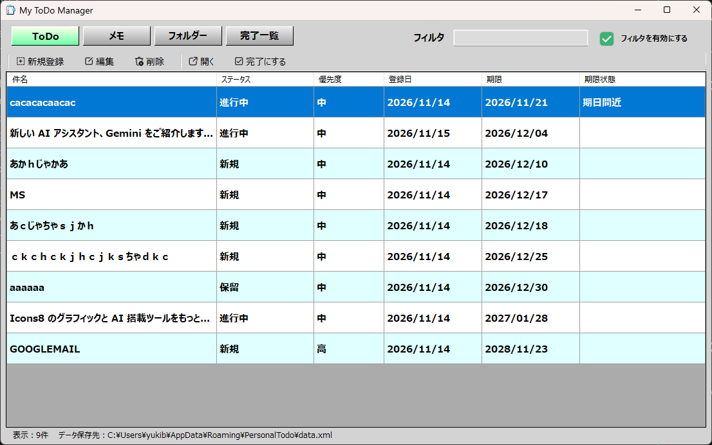
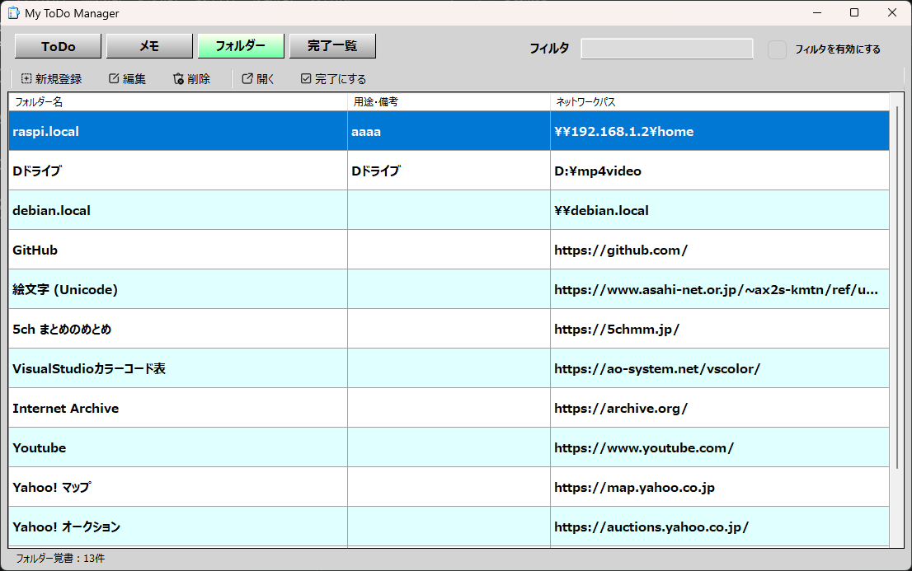

# My ToDo Manager

自分のための"ToDo"管理です。

# サンプル画面 / DEMO

# 特徴 / Features

- ToDo登録・編集・削除
- メモ登録・編集・削除
- ネットワークフォルダー覚書の登録・編集・削除
- メールURLの貼り付けと既定ブラウザーでの起動
- フォルダーをエクスプローラーで開く
- 初期期限を登録日から7日後に設定
- 期限なしへの変更
- ステータス: 新規、進行中、保留、回答待ち、完了
- 優先度: 低、中、高
- 本文への日時付き追記
- 完了ToDoを完了一覧に分離
- XMLへの保存

# 必要環境 / System Requirements

Windows 11 の標準機能で
* Windows 11 23H2 or Higher
* C# 5.0 / .NET Framework 4.8.1
* Visual Studio Code or サクラエディタ

# インストール / Installation

同包の"コンパイル.bat"を実行して、"todomgr.exe"を作成します。

# ライセンス / License

The MIT License (MIT)

Copyright 2026 Suzume-Code

Permission is hereby granted, free of charge, to any person obtaining a copy of this software and associated documentation files (the "Software"), to deal in the Software without restriction, including without limitation the rights to use, copy, modify, merge, publish, distribute, sublicense, and/or sell copies of the Software, and to permit persons to whom the Software is furnished to do so, subject to the following conditions:

The above copyright notice and this permission notice shall be included in all copies or substantial portions of the Software.

THE SOFTWARE IS PROVIDED "AS IS", WITHOUT WARRANTY OF ANY KIND, EXPRESS OR IMPLIED, INCLUDING BUT NOT LIMITED TO THE WARRANTIES OF MERCHANTABILITY, FITNESS FOR A PARTICULAR PURPOSE AND NONINFRINGEMENT. IN NO EVENT SHALL THE AUTHORS OR COPYRIGHT HOLDERS BE LIABLE FOR ANY CLAIM, DAMAGES OR OTHER LIABILITY, WHETHER IN AN ACTION OF CONTRACT, TORT OR OTHERWISE, ARISING FROM, OUT OF OR IN CONNECTION WITH THE SOFTWARE OR THE USE OR OTHER DEALINGS IN THE SOFTWARE.
